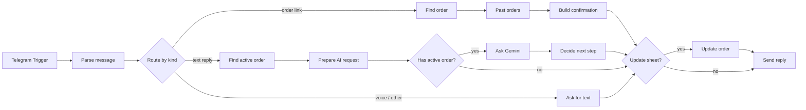

# COD Order Confirmation Agent

A Telegram agent for small f-commerce shops in Bangladesh. It confirms cash-on-delivery orders with the customer before they reach the courier: it checks the address and phone, handles changes and cancellations in Bangla, English or Banglish, and keeps the seller's Google Sheet up to date.

Built with **n8n**, the **Gemini API** (`gemini-3.5-flash-lite`, free tier), **Google Sheets** and the **Telegram Bot API**.

   **Demo video (3 min):** [Watch the walkthrough on Google Drive](https://drive.google.com/file/d/1zPiMCdmyeNp5QeHcsI73vJZAR3AqeW46/view?usp=sharing)

---

## The problem

Most Facebook shops in Bangladesh sell on cash on delivery. A share of those orders never get paid for: fake orders, wrong numbers, addresses a rider can't find, or buyers who changed their mind. The seller still pays the courier both ways. So most shops call every customer before shipping, which takes hours each day.

This agent does that call as a chat. Only confirmed orders, with a reachable phone and a complete address, reach the **Ready to ship** list.

## What it does

| Customer says | Agent does | Order status |
|---|---|---|
| Opens the order link | Sends the order summary, built from the sheet | `awaiting_customer` |
| "ha thik ase" / "হ্যাঁ" | Confirms, but only if the phone is valid and the address is complete. Otherwise asks for the missing part. | `confirmed` |
| A new address | Saves it and sends the updated summary for one more yes. A move in or out of Dhaka changes the delivery charge, so it goes to the seller. | `awaiting_customer` or `needs_seller` |
| A new phone (Bangla digits and +88 accepted) | Normalises it to `01XXXXXXXXX` and checks it is a valid mobile number | `awaiting_customer` |
| Wants a different size or product | Never changes the order itself; passes it to the seller with the customer's words | `needs_seller` |
| Cancels | Records the reason | `cancelled` |
| Asks about delivery, payment or returns | Answers from the shop policy, then asks for confirmation again | unchanged |
| Unclear twice, or anything else | Hands over to a person | `needs_seller` |
| Sends a voice note, sticker or photo | Politely asks for a text reply | unchanged |

Every order also gets **risk flags** for the seller: `invalid_phone`, `address_incomplete`, `high_value` (over 5,000 BDT), `cancelled_before` (same phone cancelled an earlier order) and `total_mismatch`.

## How it works



One customer message is one workflow run. The code for every Code node is in [`n8n/code/`](n8n/code), and the full workflow is in [`n8n/workflow.json`](n8n/workflow.json).

## Design decisions

**1. Facts come from the sheet, not the AI.**
The order summary, prices and totals are built by code from the seller's sheet. Gemini never writes a price, so it can't get one wrong, and the first message costs no tokens. If the sheet's total doesn't add up (quantity × price + delivery), the order is never shown to the customer; it goes to the seller.

**2. The AI understands, the code decides.**
Gemini reads the customer's reply and returns a fixed JSON shape, enforced with a response schema: intent, new address or phone, whether the address is complete and inside Dhaka, the cancel reason, and a short reply. Every decision about the order is plain code in [`decide-next-step.js`](n8n/code/decide-next-step.js). That makes the rules easy to read, test and change, and a model mistake can't confirm a bad order.

**3. The smallest model that does the job.**
Reading a short chat reply doesn't need a large model. `gemini-3.5-flash-lite` handled Bangla, English and Banglish correctly in testing. The model name is a single constant, so a harder case can move to a bigger model without touching the logic.

**4. Save first, then reply.**
In an early version the bot replied first and saved second. During testing, Google Sheets returned an internal error on a save, so the customer was told "confirmed" while the sheet still said `awaiting_customer`. Now the state is saved before the reply is sent, and the Sheets and Gemini nodes retry on failure. The bot only says what is actually recorded.

**5. Never ignore the customer.**
Every path ends in a reply: unknown order, no order waiting, unsupported message type, or an AI failure. If Gemini fails or returns something unusable, the customer gets a holding message and the order goes to the seller with the error in `seller_note`.

**6. Small security choices.**
- Order IDs from the link are validated as numbers before they're used.
- An order already linked to one Telegram account can't be opened from another, because order numbers are easy to guess and the summary contains an address.
- Customer messages are treated as data. The prompt tells the model to ignore instructions inside them.
- API keys live only in n8n credentials; the exported workflow contains none.

## Bugs found while testing

| What happened | Cause | Fix |
|---|---|---|
| The bot kept asking for a phone number it had just been given | Google Sheets stored `01712345678` as a number and dropped the leading 0 | Phone and chat ID columns set to plain text, and the code restores a missing 0 before validating |
| A returning customer was told the order belonged to another account | The sheet returned the chat ID as a number; the code compared it with text | Chat IDs compared as numbers |
| Customer told "confirmed", sheet not updated | Google Sheets internal error during the save | Save before replying, with retries |

## Cost

Gemini's response reports token usage, and the agent adds it to `tokens_used` on each order. In testing, one AI reply used about **660 input and 100 output tokens**, roughly 760 in total.

On the free tier this costs nothing. At the paid price for `gemini-3.5-flash-lite` listed in October 2026 ($0.30 per 1M input tokens, $2.50 per 1M output tokens; prices change, so check [Google's pricing page](https://ai.google.dev/gemini-api/docs/pricing)), one AI reply costs about **$0.0005**. A typical order needs one to three, so well under **$0.002 per order**. The first confirmation message uses no AI at all.

## Run it yourself

You need an [n8n](https://n8n.io) instance (n8n Cloud or self-hosted), a Google account, a Telegram bot token from [@BotFather](https://t.me/BotFather) and a [Gemini API key](https://aistudio.google.com).

1. **Sheet:** create a Google Sheet, rename the first tab `Orders`, and import [`sample-data/orders.csv`](sample-data/orders.csv) with *Convert text to numbers* unticked. Select columns **D** (phone) and **M** (telegram_chat_id) and set **Format → Number → Plain text**.
2. **Ready to ship tab:** add a second tab named `Ready to ship` and put this in A1:
   ```
   =QUERY(Orders!A1:T, "select A, C, D, E, F, G, H, K, P where L = 'confirmed'", 1)
   ```
3. **Import:** in n8n, create a workflow and import `n8n/workflow.json`.
4. **Credentials:**
   - Telegram API: your bot token
   - Google Sheets OAuth2: sign in with Google
   - Header Auth named `Gemini API key`: header name `x-goog-api-key`, value your Gemini key
5. **Point to your sheet:** in the five Google Sheets nodes, set *Document* to your sheet's URL.
6. **Publish** the workflow, then open `https://t.me/<your_bot>?start=1001` in Telegram.

### Test script

| Order | Send | Shows |
|---|---|---|
| 1001 | `/start 1001`, then `thikana change hobe: House 9, Road 11, Banani, Dhaka`, then `হ্যাঁ` | Address change, then confirmation |
| 1003 | `/start 1003`, then `ha` | Refuses to confirm: invalid phone, vague address, high value |
| 1003 | `amar number ০১৭১২৩৪৫৬৭৮`, then a full address, then `ha` | Bangla digits normalised, confirmed for outside Dhaka (3 to 5 days) |
| 1005 | `/start 1005`, then `order ta cancel korte chai, onno jaygay kom dame paisi` | Repeat canceller flagged, reason recorded |

Run the orders one at a time: the agent replies about the chat's most recent order that is still waiting.

## Privacy

The demo uses made-up orders only. On Gemini's free tier, Google may use prompts to improve its products and human reviewers may read them, so real customer data should only go through a paid tier.

## Limitations and next steps

- **WhatsApp:** most Bangladeshi customers are on WhatsApp. The logic doesn't depend on the channel; moving over means replacing the Telegram trigger and send nodes with the WhatsApp Business Cloud API, and sending the first message as an approved template instead of a deep link.
- **Voice notes:** `prepare-ai-request.js` already builds an audio request for Gemini. What's missing is downloading the Telegram voice file and converting it to base64.
- **No-reply follow-up:** a scheduled run that reminds customers after a few hours and marks the order `no_response` for a call.
- **Courier booking:** send confirmed orders straight to a courier's API (Pathao, Steadfast, RedX) instead of a sheet tab.
- **Concurrency:** two messages about the same order within a second can still race. A database with row locking (Supabase or Postgres) would replace Google Sheets at higher volume.
- **Evals:** a fixed set of real-style replies (Banglish, typos, mixed intents) with expected intents, run after every prompt change.

## Files

```
n8n/
  workflow.json              the n8n workflow (credentials not included)
  code/
    parse-message.js         flattens a Telegram update
    build-confirmation.js    order summary and risk flags, from the sheet
    prepare-ai-request.js    finds the active order, builds the Gemini request
    decide-next-step.js      the order rules
    ask-for-text.js          reply for unsupported message types
sample-data/
  orders.csv                 six test orders covering every path
```
